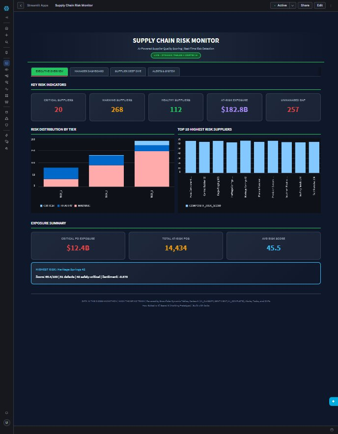
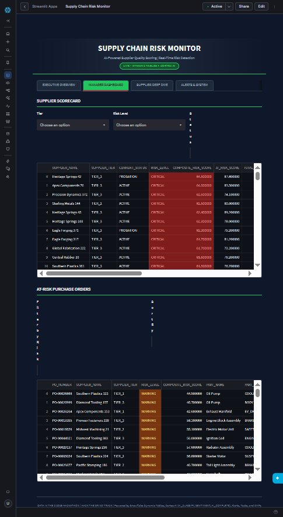

# Supply Chain Risk Monitor

AI-powered supplier quality scoring and real-time risk detection built on Snowflake Dynamic Tables, Cortex AI, and Streamlit-in-Snowflake.

__Data in the D 2026 Hackathon | Hack the Grind Track__



---

## What It Does

Continuously scores 400 auto manufacturing suppliers by combining AI-classified defect analysis, customer sentiment, quality ratings, and warranty data into a single composite risk score. Flags at-risk purchase orders, alerts when critical risk goes unmanaged, and gives supply chain managers one dashboard to see everything.

- 8,000 defect descriptions classified by AI_CLASSIFY into risk categories
- 30,000 warranty complaints scored by SENTIMENT for customer anger
- $182.8B in purchase order exposure tracked in real time
- Hourly refresh via chained Dynamic Tables (DT2 reads DT1)
- 60-minute alert cycle for unmanaged critical suppliers
- Daily risk score snapshots for trend tracking

---

## Architecture

```
              AUTO_MFG_DW (Challenge Dataset)
         ┌────────────┬───────────┬───────────┐
         │ SUPPLIERS  │  DEFECTS  │ WARRANTY  │
         │ (400)      │ (8,000)   │ (30,000)  │
         └─────┬──────┴─────┬─────┴─────┬─────┘
               │    AI_CLASSIFY    SENTIMENT
               │        │              │
         ┌─────▼────────▼──────────────▼──────┐
         │  SUPPLIER_QUALITY_SCORE (DT, 1hr)  │
         │  Composite Risk Score per supplier  │
         └───────┬──────────┬──────────┬──────┘
          ┌──────▼───┐  ┌───▼────┐  ┌──▼──────────┐
          │AT_RISK_  │  │ ALERT  │  │RISK_SCORE_  │
          │PURCHASE_ │  │(60min) │  │SNAPSHOT     │
          │ORDERS(DT)│  │        │  │(daily 6AM)  │
          └──────────┘  └────────┘  └─────────────┘
                 │
         ┌───────▼────────────────────────────┐
         │    SUPPLY_CHAIN_MONITOR            │
         │    (Streamlit, 5 tabs)             │
         │    + AI_COMPLETE on-demand         │
         └────────────────────────────────────┘
```

---

## Dashboard (5 Tabs)

| Tab | Audience | Features |
|---|---|---|
| Executive Overview | C-suite | 5 KPIs with hover tooltips, Vega-Lite charts (risk by tier, top 10), Top-N selector, "View in Explorer" cross-tab nav |
| Manager Dashboard | Operations | Filterable supplier scorecard (3 filters), at-risk PO table with exposure color coding |
| Supplier Deep Dive | Analysts | Single-supplier investigation, 8 metric cards, AI_COMPLETE risk summary button |
| Data Explorer | Power users | 12 filters (3 rows), Export to Stage, Show SQL, results summary |
| Alerts and System | Ops/Admin | Alert history, pipeline architecture reference, feature inventory |

Dark/light theme toggle with smooth CSS transitions. All charts and cards adapt automatically.



---

## Composite Risk Score

```
Score (0-100) =  30% AI_CLASSIFY defect severity
               + 20% defect volume (normalized)
               + 20% inverse quality rating
               + 15% warranty claim volume (normalized)
               + 15% negative customer sentiment
```

| Score | Level | Suppliers |
|---|---|---|
| >= 58 | CRITICAL | 33 |
| 38-57 | WARNING | 294 |
| < 38 | HEALTHY | 73 |

---

## Snowflake Features Used

| Feature | Object | Purpose |
|---|---|---|
| Dynamic Tables (x2) | SUPPLIER_QUALITY_SCORE, AT_RISK_PURCHASE_ORDERS | Chained pipeline with 1-hour TARGET_LAG |
| AI_CLASSIFY | Inside DT1 | Categorize 8,000 defect descriptions into risk categories |
| SENTIMENT | Inside DT1 | Score 30,000 warranty customer complaints |
| AI_COMPLETE | Streamlit on-demand | Natural-language supplier risk summaries |
| Alert | SUPPLIER_RISK_ALERT | 60-min check for unmanaged critical suppliers |
| Task | RISK_SCORE_SNAPSHOT | Daily 6 AM ET snapshots for trend analysis |
| DMF | UNMANAGED_RISK_COUNT | Data quality metric for risk-action gap |
| Streamlit | SUPPLY_CHAIN_MONITOR | 5-tab dashboard with dark/light theme |

---

## Project Files

| File | Description |
|---|---|
| `streamlit_app.py` | Main Streamlit application (830 lines) |
| `ARCHITECTURE.md` | Technical deep dive: data flow, DDL, scoring formula, DT chain |
| `USER-GUIDE.md` | How to use the app: tabs, KPIs, filters, export, risk interpretation |
| `BUILD-JOURNAL.md` | Narrative build story: decisions, gotchas, trade-offs |
| `NOTE4JUDGES.md` | Comprehensive judges brief with timeline, audit results, bake score |
| `EXECUTIVE_SUMMARY.docx` | Executive summary for stakeholders (Word format) |
| `TECHNICAL_ARCHITECTURE.docx` | Deep technical architecture document (Word format) |
| `VIDEO_SCRIPT.md` | STAR-method video script for demo recording (3:30-4:00 min) |
| `PROGRESS.md` | Step-by-step build tracker (16 steps across 4 sessions) |
| `LOG.md` | Chronological session log across 4 CoCo sessions |
| `GOTCHA.md` | 12 documented pitfalls with fixes |
| `QA-DEFECTS.md` | QA walkthrough findings -- all P0s resolved |
| `Supply_Chain_Risk_Monitor.pptx` | PowerPoint presentation |

---

## Snowflake Object Inventory

All objects in `DEFAULT_DATABASE.PUBLIC`:

| Object | Type | Rows | Status |
|---|---|---|---|
| SUPPLIER_QUALITY_SCORE | Dynamic Table | 400 | Refreshing (1hr) |
| AT_RISK_PURCHASE_ORDERS | Dynamic Table | ~16,000 | Refreshing (1hr) |
| SUPPLIER_RISK_ALERT | Alert | -- | RESUMED (60 min) |
| RISK_SCORE_SNAPSHOT | Task | -- | RESUMED (daily 6AM ET) |
| ALERT_HISTORY | Table | varies | Alert audit log |
| RISK_SCORE_HISTORY | Table | 400+ | Trend snapshots |
| UNMANAGED_RISK_COUNT | DMF | -- | Manual call |
| STREAMLIT_STAGE | Stage | -- | App + export storage |
| SUPPLY_CHAIN_MONITOR | Streamlit | -- | Deployed |

---

## How It Was Built

Built in a single hackathon day using CoCo (Cortex Code Desktop) across 4 sessions:

1. Explored 22 databases, chose AUTO_MFG_DW for Detroit thematic fit
2. Built 2 chained Dynamic Tables with AI_CLASSIFY + SENTIMENT
3. Created Alert (60-min) and Task (daily snapshots)
4. Built Streamlit app through 3 iterations (basic -> themed -> full-featured)
5. Full QA walkthrough with browser automation, 14 defects found and fixed
6. Hardened with error handling, empty states, loading spinners, input sanitization

See `BUILD-JOURNAL.md` for the full narrative with design decisions and trade-offs.

---

## How Baked Is It?

__Self-score: 4 (Usable by Others)__

Everything is real -- live AI functions on real data, self-refreshing pipeline, working export. The app handles empty states, bad input, and unavailable AI models gracefully. A supply chain manager who has never seen the code can open the dashboard and use it.

See `NOTE4JUDGES.md` for the detailed justification.

---

## Built With

- Snowflake Dynamic Tables, Cortex AI (AI_CLASSIFY, SENTIMENT, AI_COMPLETE), Alerts, Tasks, DMFs
- Streamlit-in-Snowflake with Vega-Lite charts
- CoCo (Cortex Code Desktop) for development
- Data in the D 2026 Hackathon, Hack the Grind Track
